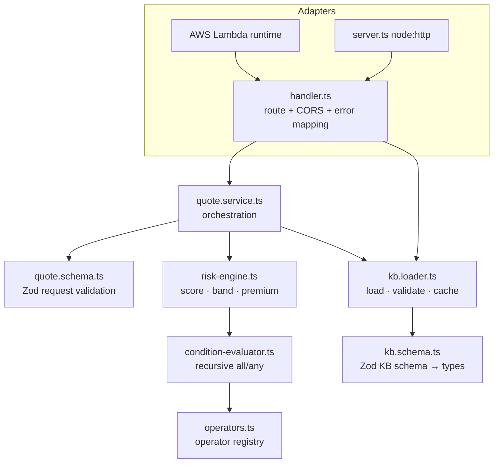
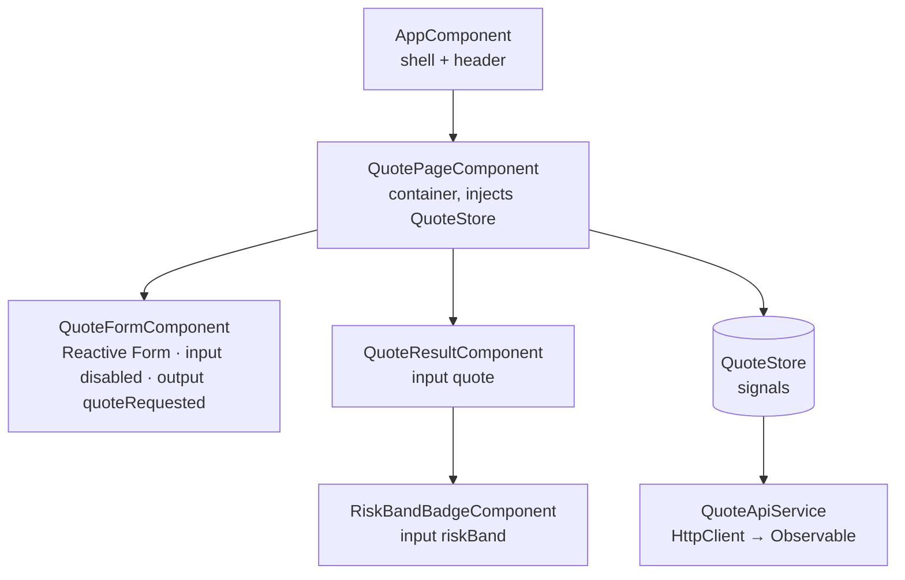

# Architecture Document — PolicyQuote

| Item | Value |
|---|---|
| Document | Solution Architecture |
| Version | 1.0 |
| Date | 2026-11-26 |
| Author role | Senior Software Architect |
| Inputs | [01-BRD.md](01-BRD.md), assessment tech stack |

---

## 1. Architectural drivers

| Driver | Source | Architectural response |
|---|---|---|
| Rules change without code change | KB-05, OBJ-2 | Declarative KB with a **generic condition interpreter** (operator registry + recursive `all`/`any`) |
| Lambda compatibility | FR-20 | Pure `handler(event, context)` core. Local HTTP server and Docker are thin **adapters** over the same handler |
| Explainability | FR-08, OBJ-3 | Engine returns an audit trail (`appliedFactors`) built from KB descriptions |
| Determinism & no external calls | NFR-01 | Pure functions. The KB is a local file. No network I/O in the engine |
| Type safety | NFR-02 | TS `strict`. KB types are **inferred from the Zod schema** (one source of truth). No `any` |
| Signals-based UI | NFR-04/05 | Standalone components with a signal store (`signal`/`computed`/`effect`) |

## 2. Technology stack

| Layer | Choice | Version | Rationale |
|---|---|---|---|
| Frontend | Angular (standalone, zoneless) | 22.3 | Brief asks for 17+. 22 is the current major. Signals-first and zoneless by default. Requires Node ^22.22.3 / ^24.15 |
| Frontend tests | Vitest via `@angular/build:unit-test` + jsdom | Angular default | Default runner since Angular 21. No browser needed in CI |
| Styling | Hand-written CSS (custom properties) | — | NFR-03 bans UI libraries |
| Backend runtime | Node.js | 20+ (dev on 24) | Matches the AWS Lambda `nodejs20.x`/`nodejs22.x` runtimes |
| Language (both) | TypeScript | 6.0 | `strict`, `noUncheckedIndexedAccess`. Backend uses `module`/`moduleResolution: node16` (node10 resolution is deprecated in TS 6). TS 7 is not yet supported by Angular 22 (peer `>=6.0 <6.1`) |
| Validation | Zod | 4.x | Required by the brief. Also validates the KB itself |
| Backend tests | Jest + ts-jest | 30.x | Required by the brief |
| Local HTTP | `node:http` adapter | built-in | No Express needed: one route, zero extra attack surface |
| Container | Multi-stage Dockerfile, `node:22-alpine` | — | Bonus: Fargate-ready image with `/health` |

## 3. System context

```mermaid
flowchart LR
  C[Customer browser] -->|HTTPS| FE[Angular SPA<br/>:4200]
  FE -->|POST /policy/quote<br/>dev proxy| BE[Quote API<br/>handler(event, context)]
  BE -->|read + validate + cache| KB[(kb/risk-kb.json)]
  RA[Risk analyst] -->|PR edits| KB
```

There are no other systems. The backend makes **no outbound calls** (NFR-01).

## 4. Repository layout

```
/
├── kb/
│   └── risk-kb.json              ← THE Knowledge Base (first-class artefact, KB-01)
├── backend/
│   ├── src/
│   │   ├── handler.ts            ← Lambda entry: export handler(event, context)
│   │   ├── server.ts             ← local/Fargate HTTP adapter → handler
│   │   ├── http/                 ← routing, response helpers, CORS
│   │   ├── kb/                   ← KB schema (Zod), inferred types, loader/cache
│   │   ├── engine/               ← operators registry, condition evaluator, risk engine
│   │   └── quote/                ← request schema, quote service (orchestration)
│   ├── test/                     ← Jest specs + KB fixtures
│   ├── scripts/validate-kb.ts    ← `npm run kb:validate`
│   └── Dockerfile
├── frontend/
│   └── src/app/
│       ├── core/                 ← models, QuoteApiService, QuoteStore (signals)
│       └── features/quote/       ← page, form, result, risk-band-badge components
├── docs/                         ← BRD, Architecture, Plan, Test Report
├── CLAUDE.md                     ← agent system prompt (project conventions)
├── .claude/skills/add-kb-factor/ ← agent skill for the live-demo workflow
├── AGENT_LOG.md · SOLUTION.md · README.md
```

## 5. Backend design

### 5.1 Layering



Dependency rule: `engine/` depends only on `kb/` types. It knows nothing about HTTP, files or Zod request parsing, so it is pure and trivially unit-testable.

### 5.2 Request flow

```mermaid
sequenceDiagram
  participant FE as Angular
  participant H as handler
  participant KB as kb.loader
  participant Q as quote.service
  participant E as risk-engine
  FE->>H: POST /policy/quote {json}
  H->>H: route match, parse JSON (400 on malformed)
  H->>KB: getKnowledgeBase()
  KB-->>H: validated KB (cached; reload if file mtime changed)
  H->>Q: createQuote(body, kb)
  Q->>Q: QuoteRequestSchema.safeParse (400 on issues)
  Q->>E: scoreRisk(input, kb.factors)
  E-->>Q: {score, appliedFactors}
  Q->>E: resolveBand(score, kb.riskBands)
  Q->>E: calculatePremium(kb, band)
  Q-->>H: QuoteResponse
  H-->>FE: 200 + CORS headers
```

### 5.3 KB schema (v1, extends the brief's example)

```jsonc
{
  "schemaVersion": 1,                 // engine compatibility contract (breaking changes bump this)
  "version": "1.1.0",                 // content version of the rule set (returned in API)
  "basePremium": 300,
  "coverageLoadFactor": 1.2,
  "currency": "GBP",
  "riskBands": {
    "STANDARD":  { "min": 0,  "max": 25,   "riskMultiplier": 1.0, "label": "Standard",  "summary": "..." },
    "ELEVATED":  { "min": 26, "max": 60,   "riskMultiplier": 1.5, "label": "Elevated",  "summary": "..." },
    "HIGH_RISK": { "min": 61, "max": null, "riskMultiplier": 2.2, "label": "High risk", "summary": "..." }
  },
  "factors": [
    { "id": "...", "description": "...", "points": 15, "perOccurrence": true,
      "condition": { "field": "previousClaims", "operator": "between", "min": 1, "max": 2 } },
    { "id": "flat_high_value", "description": "...", "points": 35,
      "condition": { "all": [
        { "field": "propertyType",  "operator": "eq", "value": "Flat" },
        { "field": "propertyValue", "operator": "gt", "value": 500000 } ] } }
  ]
}
```

**Deviations from the brief's example, with reasons:**
1. `riskMultiplier` moved *into* each band. The brief lists multipliers in a table. Keeping them in code would break "no hardcoded scoring values".
2. The top band uses `max: null` (open-ended) instead of `999`. With 50 claims × 30 points the score can exceed 999, and a gap there would be a runtime error.
3. `label` and `summary` per band, so all customer-facing text about risk is KB content (KB-10).
4. `schemaVersion` (integer contract) is separate from `version` (content semver). This is the basis for safe evolution (§5.7).

**Condition grammar** (recursive, validated by Zod `z.lazy`):

```
Condition     := LeafCondition | { "all": Condition[] } | { "any": Condition[] }
LeafCondition := { field: QuoteField, operator: Operator, ...operator-specific params }
```

| Operator | Params | Field type | Semantics |
|---|---|---|---|
| `eq` / `neq` | `value: string\|number` | any | strict (in)equality. Strings compared case-insensitively |
| `gt` `gte` `lt` `lte` | `value: number` | number | numeric comparison |
| `between` | `min`, `max` | number | `min ≤ x ≤ max` |
| `outside_range` | `min`, `max` | number | `x < min ∨ x > max` |
| `in` | `values: (string\|number)[]` | any | membership (case-insensitive for strings) |
| `starts_with` | `value: string \| string[]` | string | case-insensitive prefix, any-of when array |

Each leaf is a **Zod discriminated union on `operator`**, so a malformed rule (e.g. `between` with no `max`) is rejected at load time with a precise path such as `factors[3].condition.max`.

**Load-time semantic checks** (`superRefine`):
- Factor `id`s are unique.
- Numeric operators only target numeric fields. This is checked against a field-type map derived from the request schema.
- Bands are contiguous with no gaps or overlaps, start at 0, and only the last band may be open-ended.
- `perOccurrence` needs a numeric `occurrenceField`, or a leaf condition on a numeric field.

### 5.4 Engine: table-driven, no `switch`

```ts
// operators.ts — a registry object, not a switch
export const OPERATORS: OperatorRegistry = {
  eq:  (actual, c) => normalise(actual) === normalise(c.value),
  gt:  (actual, c) => isNumber(actual) && actual > c.value,
  between: (actual, c) => isNumber(actual) && actual >= c.min && actual <= c.max,
  starts_with: (actual, c) => typeof actual === 'string' && toList(c.value).some(p => upper(actual).startsWith(upper(p))),
  // ...
};

// condition-evaluator.ts — recursive interpreter
evaluate(cond, input) =
  isAll(cond) ? cond.all.every(c => evaluate(c, input)) :
  isAny(cond) ? cond.any.some(c => evaluate(c, input)) :
  applyOperator(cond, input[cond.field]);

// risk-engine.ts — fold over the KB
scoreRisk(input, factors) = factors
  .filter(f => evaluate(f.condition, input))
  .map(f => ({ id, description, points: f.points * occurrences(f, input) }))
```

Adding an *operator* is a one-line registry change plus one schema branch. That is code, by design. Adding, changing or removing a *factor* is KB-only. This split is the extensibility boundary.

### 5.5 Premium formula

```
annualPremium  = round2(basePremium × band.riskMultiplier × coverageLoadFactor)
monthlyPremium = round2(annualPremium / 12)
```

`round2` uses `Math.round((x + Number.EPSILON) * 100) / 100` so that IEEE-754 artefacts (e.g. `539.9999999`) cannot leak through.

### 5.6 KB loading & caching

- The path comes from `KB_PATH` env var, or defaults to `<repo>/kb/risk-kb.json`.
- On first use the loader reads the file, `JSON.parse`s it, runs the Zod schema and freezes the result. It is then cached for the warm Lambda container.
- On each request a cheap `fs.statSync(mtime)` check runs. If the file changed, it is re-validated and swapped atomically. **If the new KB is invalid, the last-known-good KB stays active** and the error is logged. A typo therefore never takes pricing down, and the live demo works without restarting the server.
- `GET /health` → `{ status, kbVersion, schemaVersion, factorCount }`.

### 5.7 KB versioning in production (bonus — design)

| Concern | Approach |
|---|---|
| Storage | KB lives in Git (PR review by underwriting + engineering, CI runs `kb:validate` + the test suite). On merge it is published to **S3 (versioned bucket)** or **AWS AppConfig** as an immutable `risk-kb@<version>.json` |
| Selection | Lambda env / AppConfig pointer names the active version, so promotion and rollback are a config flip, not a deploy. Each quote echoes `kbVersion` for audit |
| Non-breaking changes | Same `schemaVersion`. Any engine on that schema accepts it. Hot-swapped via cache TTL/mtime |
| Breaking schema changes | Bump `schemaVersion`. The engine declares `SUPPORTED_SCHEMA_VERSIONS` and **refuses** (keeps last-known-good) a KB it can't interpret. Rollout is *expand → migrate → contract*: (1) deploy an engine supporting N and N+1, (2) publish the N+1 KB, (3) drop N later. The KB never outruns the engine |
| Audit / replay | Persisting `{input, kbVersion}` per quote allows any historic quote to be re-priced exactly |

## 6. API contract

### `POST /policy/quote`

Request:
```json
{ "customerName": "Jane Doe", "age": 30, "propertyType": "House",
  "propertyValue": 300000, "postcode": "SW1A 1AA", "previousClaims": 2 }
```

200 response:
```json
{
  "monthlyPremium": 45, "annualPremium": 540, "currency": "GBP",
  "riskBand": "ELEVATED", "riskBandLabel": "Elevated", "riskScore": 30,
  "riskSummary": "Elevated risk ...",
  "coverageDetails": { "basePremium": 300, "riskMultiplier": 1.5, "coverageLoadFactor": 1.2,
                       "propertyType": "House", "propertyValue": 300000, "formula": "300 × 1.5 × 1.2" },
  "appliedFactors": [ { "id": "previous_claims_low", "description": "1–2 previous claims", "points": 30, "occurrences": 2 } ],
  "kbVersion": "1.1.0"
}
```

Errors (uniform envelope): `{ "error": { "code": "VALIDATION_ERROR" | "BAD_REQUEST" | "NOT_FOUND" | "METHOD_NOT_ALLOWED" | "INTERNAL_ERROR", "message": "...", "issues"?: [{ "path": "age", "message": "..." }] } }`

### `GET /health` → `200 { "status": "ok", "kbVersion": "1.1.0", "schemaVersion": 1, "factorCount": 6 }`

## 7. Frontend design

### 7.1 Component tree



### 7.2 State (Signals only)

| Signal | Kind | Purpose |
|---|---|---|
| `loading` | `signal<boolean>` | request in flight |
| `quoteResult` | `signal<QuoteResponse \| null>` | last successful quote |
| `errorMessage` | `signal<string \| null>` | user-facing error |
| `hasResult`, `appliedFactorCount`, `totalFactorPoints` | `computed` | derived view state |
| `formValid` | `toSignal(form.statusChanges)` | bridges reactive form status into signals |
| `canSubmit` | `computed(formValid && !disabled)` | submit button state |
| side effects | `effect()` + `afterRenderEffect()` | `effect` syncs `document.title` with the latest quote. `afterRenderEffect` moves focus to the result heading once it has rendered (a11y). While a new request is in flight, the previous result is dimmed, not cleared |

RxJS is used **only** at the HTTP boundary (`HttpClient` returns an `Observable`, subscribed once per request). There is no `BehaviorSubject`/`Subject` anywhere (NFR-04).

### 7.3 Conventions
- `ChangeDetectionStrategy.OnPush`, `input()`/`output()` functions, `@if`/`@for` control flow, `inject()`.
- Zoneless (`provideZonelessChangeDetection`). Signals drive rendering.
- The dev server proxies `/policy` and `/health` to `http://localhost:3000` (`proxy.conf.json`), so the same relative URLs work behind a single origin in production (CloudFront → API Gateway).
- Design tokens are CSS custom properties. The badge shows colour **and** text (accessibility).

## 8. Cross-cutting concerns

| Concern | Decision |
|---|---|
| Error handling | Handler maps typed errors (`ValidationError`, `KnowledgeBaseError`) to status codes. Unknown errors → 500 with a generic message. Details are logged server-side only |
| Logging | Single-line JSON `console` logs (CloudWatch-friendly). No PII beyond what is needed (customer name is not logged) |
| Security | Body limit 10 KB on the local server. Zod `strict()` rejects unknown keys. CORS origin configurable via `CORS_ORIGIN` |
| Config | `PORT`, `KB_PATH`, `CORS_ORIGIN` env vars. Sensible defaults for `npm start` |
| Performance | KB parsed once per container. Scoring is O(factors × condition-depth), microseconds |

## 9. Deployment views

- **Local:** `backend: npm start` (tsc → `node dist/server.js` on :3000), `frontend: npm start` (`ng serve` on :4200 with proxy).
- **Lambda:** bundle `dist/` + KB. Handler `dist/handler.handler`. API Gateway HTTP API route `POST /policy/quote`.
- **Fargate (bonus):** multi-stage Dockerfile. Builder stage compiles TS. Runtime stage has prod deps only, runs as a non-root `node` user, `HEALTHCHECK` hits `/health`, KB copied to `/app/kb` (or mounted / pulled from S3 via `KB_PATH`).

## 10. Architecture decision records (summary)

| ADR | Decision | Alternatives rejected |
|---|---|---|
| ADR-1 | Interpret a JSON condition AST with an operator registry | `if/else` per factor (violates KB-06). `eval`/JS expressions in KB (security). JSON-Logic library (extra dependency, less typed, harder to explain live) |
| ADR-2 | Derive TS types from Zod (`z.infer`) | Hand-written interfaces + separate validator (drift risk). Interfaces are still exported as named types |
| ADR-3 | Multipliers and summaries in the KB | Constants in code (violates "no hardcoded scoring values") |
| ADR-4 | `node:http` adapter over the Lambda handler | Express/Fastify (unnecessary for one route). `serverless-offline` (heavy) |
| ADR-5 | Last-known-good KB on invalid reload | Fail all requests (outage from a typo) |
| ADR-6 | Signals store service + presentational components | NgRx (overkill). `BehaviorSubject` services (banned) |
